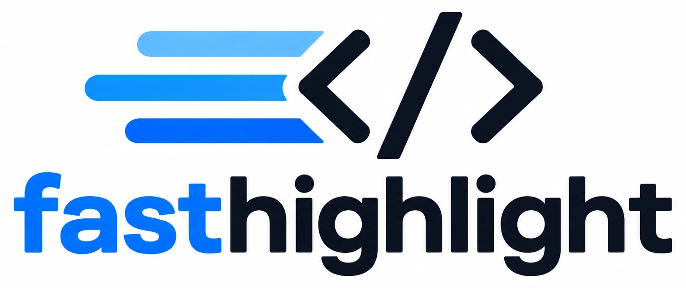

<p align="center"></p>

# fasthighlight

fasthighlight is fast syntax highlighting written in Go, without regular expressions: each supported language has its own hand-written tokenizer. The highlighting follows the language definitions of [Chroma](https://github.com/alecthomas/chroma) 2.27.0, with a few deliberate fixes. Add it to [goldmark](https://github.com/yuin/goldmark) to highlight the code blocks in Markdown, or use the command `fhl` from a terminal, a script or a program in another language to turn Markdown into HTML, up to a basic static site.

✨ Try it in your browser: [the demo](https://toshi-kuji.github.io/fasthighlight/demo/) (a WebAssembly build made only for the demo; fasthighlight does not ship one).

- **Fast.** In our measurements (v0.6.4), converting a Markdown document was about 4.5 to 6.5 times as fast as Node with markdown-it and highlight.js, and about 7 to 28 times as fast as Chroma with all its languages ([numbers](#speed)).
- **Two ways in.** Go packages for Go programs (`markdown` adds highlighting to goldmark; `fasthighlight` highlights code on its own), and the `fhl` command for everything else (static site builds in other languages, CI, AI agents).
- **Small dependency footprint.** The highlighting package has no dependencies outside the standard library. The `markdown` package depends only on goldmark.
- **Plain HTML and CSS.** Code blocks become `<pre class="highlight">` with short, widely used token classes (`k`, `s`, `nf`, … as in Pygments, Chroma and Rouge). The output is the same for the same input, byte for byte.

## Supported languages

fasthighlight supports 34 languages: Bash, Bash Session (`console`), C, C#, C++, CSS, Diff, Docker, Go, GraphQL, HTML, HTTP, INI, Java, JavaScript, JSON, Kotlin, Makefile, Markdown, PHP, PowerShell, Protocol Buffer, Python, R, React (JSX), Ruby, Rust, SCSS, SQL, Swift, TOML, TypeScript, XML, YAML.

The names, aliases and file name patterns are the same as Chroma's (`fhl --list-langs` prints them). Code blocks in other languages, or without a language name, are escaped but not colored. Code blocks marked as plain text (`text`, `plaintext`, `plain` or `no-highlight`, the names of Chroma's plain text lexer) are escaped too, and are not reported as uncolored, since that is what they ask for. Write ` ```text ` for output, logs and anything else that should stay plain.

## The command: `fhl`

### Install

- Download an archive for your system (Linux, macOS or Windows; amd64 or arm64) from the [releases page](https://github.com/toshi-kuji/fasthighlight/releases), and put `fhl` on your `PATH`. It is a single binary with no dependencies.
- Or, with Go: `go install github.com/toshi-kuji/fasthighlight/cmd/fhl@latest`

### Use

```sh
fhl README.md                      # README.html and highlight.css next to README.md
fhl docs/                          # an .html next to each .md in docs/, and a highlight.css per folder
fhl -o dist/ docs/                 # write into dist/, keeping the folder layout
fhl --single-html README.md        # one standalone HTML file: the CSS in <head>, heading ids
fhl --static-site -o dist/ docs/   # a static site: full pages, heading ids, other files copied
fhl -o - README.md                 # body-only HTML to standard output
cat note.md | fhl -o note.html -   # read standard input
fhl main.go                        # a code file becomes one highlighted code block
fhl --theme dark:github docs/      # choose the colors (light, dark or both, and a theme)
fhl --print-css > highlight.css    # only the CSS, for your own build or template
fhl --code-blocks page.md          # only the code blocks, colored, one line of JSON each
fhl --check --strict docs/         # fail (exit status 2) if a code block is not colored
fhl -o dist/ docs/ --json          # machine-readable result, for scripts and AI agents
fhl --help                         # all flags, with examples
```

By default `fhl` writes the HTML of the document body only (no `<html>` or `<head>`), plus `highlight.css` with the code colors, so that you or an AI agent can put it into your own page and style it. `--single-html` makes a page that opens as it is, with ids on headings so that links within the page work, and `--static-site` turns a folder into a basic static site: pages that open as they are, with ids on headings, links to `.md` files rewritten to `.html`, the other files copied, and one `highlight.css` at the top that every page links to. It has no styles beyond the code colors; add your own styles (by hand or with an AI agent) to that `highlight.css`.

Other behavior worth knowing:

- Existing files are overwritten only after asking `[y/N/a]` on a terminal. Without a terminal (CI, scripts, AI agents), `fhl` stops with an error unless `--force` is given. Files whose content would not change are left alone.
- Raw HTML in Markdown is escaped by default, so it shows up as text. `--raw-html omit` drops it, and `--raw-html unsafe` passes it through (only for Markdown you trust).
- Front matter (`---` … `---` at the top, starting with a YAML key such as `title:`) is skipped.
- Code blocks that are not colored are listed on standard error as `file:line:`, up to three for each reason (no language name, unsupported language), followed by a count of the rest. `--check` lists them all.
- Exit status: 0 for success, 1 for errors, 2 for uncolored code blocks with `--strict`.

### Themes

`--theme MODE:THEME` chooses the colors of `highlight.css` (and of the CSS in `--single-html`). Every theme has light and dark colors, and `MODE` chooses which to write:

| `MODE` | Writes |
| --- | --- |
| `light` | the light colors only |
| `dark` | the dark colors only |
| `both` | the light colors, switched to the dark ones when the viewer's device prefers dark (`prefers-color-scheme`) |

| `THEME` | Light | Dark |
| --- | --- | --- |
| `default` | fhl's own colors | fhl's own colors |
| `github` | GitHub Light Default | GitHub Dark Default |
| `vscode` | VS Code Light+ | VS Code Dark+ |
| `solarized` | Solarized Light | Solarized Dark |
| `one` | One Light | One Dark |
| `catppuccin` | Catppuccin Latte | Catppuccin Mocha |
| `tokyo-night` | Tokyo Night Light | Tokyo Night |

`THEME` can be left out for `default` (`--theme light`); without `--theme`, it is `both:default`. For a site with its own light and dark switch, `--theme-selector dark:':root[data-theme="dark"]'` (and `light:…`) adds the colors under that selector, which wins over the device setting (to ignore the device setting, see [Themes and CSS](https://toshi-kuji.github.io/fasthighlight/themes.html)), and `--no-frame` leaves out the background and text color of `pre.highlight`. `default` makes keywords bold, and every color in it has a contrast ratio of at least 6 against its background (above WCAG AA).

The colors are CSS variables (`--highlight-keyword`, `--highlight-string`, …) on `:root`, and every token class has a comment that says what it is. Change a variable to change a color. The themes other than `default` copy the colors of the original themes as they are, so some colors in them have a lower contrast.

## The library

```sh
go get github.com/toshi-kuji/fasthighlight
```

It needs Go 1.25 or later. The module has two kinds of packages:

- `github.com/toshi-kuji/fasthighlight` highlights code. It has no dependencies outside the standard library.
- `github.com/toshi-kuji/fasthighlight/markdown` turns Markdown into HTML with highlighted code blocks, using goldmark. For goldmark v2, use `github.com/toshi-kuji/fasthighlight/markdown/v2` instead: the same API and the same HTML. Only the goldmark you import is downloaded and compiled in.

Both are in the same module, so one `go get` covers them.

### Convert Markdown

```go
import (
	"github.com/toshi-kuji/fasthighlight/markdown"

	_ "github.com/toshi-kuji/fasthighlight/lang/golang" // register the languages you use (here, Go)
	// _ "github.com/toshi-kuji/fasthighlight/lang/all"  // or all the languages at once
)

err := markdown.NewConverter().Convert(src, w) // GFM to HTML
```

### Add to your own goldmark

```go
md := goldmark.New(goldmark.WithExtensions(extension.GFM, &markdown.Extension{}))
err := md.Convert(src, w)
```

A `goldmark.Markdown` with the extension can be used from several goroutines at the same time.

If you convert the Markdown yourself and need only the colored code blocks, `Converter.CodeBlocks` returns them, in order, from a parsed document (the library side of `fhl --code-blocks`). With your own goldmark, wrap its result with `markdown.NewDocument` so the document is parsed once.

### Highlight one piece of code

```go
import (
	"github.com/toshi-kuji/fasthighlight"
	_ "github.com/toshi-kuji/fasthighlight/lang/golang"
)

err := fasthighlight.Highlight(w, "go", code)
```

A program that only highlights code does not import the `markdown` package, so goldmark is not compiled into it. `Highlight` may be called from several goroutines at the same time. To work with the tokens yourself, use `Language.Tokenise` (each token has a type and its text) and `WriteHTML`.

### Choose the languages

Languages are registered by importing their packages, as with `database/sql` drivers. Import only the ones you need to keep your binary small:

```go
import (
	_ "github.com/toshi-kuji/fasthighlight/lang/golang"
	_ "github.com/toshi-kuji/fasthighlight/lang/python"
)
```

As of v0.2.0, in a small program on Linux amd64 built with Go 1.25.0 and `-ldflags "-s -w"`, calling only `Highlight` took about 1.63 MB; importing the Go language added about 0.07 MB, and importing all the languages (`lang/all`) about 0.77 MB. Using `markdown.Converter` (with goldmark) added about 1.04 MB more. Only what you import is compiled into your program; the `fhl` command is not.

To list the code blocks that will not be colored before converting (for example, to warn about a language you did not import), parse the documents with `markdown.Converter.Parse`, call `markdown.Scan`, and then `markdown.Converter.Render`. To check a single language name, `fasthighlight.LookupSupported` tells whether fasthighlight supports it and which package to import.

### Output

````markdown
```go
fmt.Println("hi")
```
````

becomes

```html
<pre class="highlight" data-lang="go"><code class="language-go"><span class="nx">fmt</span><span class="p">.</span><span class="nf">Println</span><span class="p">(</span><span class="s">&#34;hi&#34;</span><span class="p">)</span>
</code></pre>
```

`data-lang` and the `language-` class (the one CommonMark recommends, which other tools read) hold the language name as written in the Markdown. The library writes no CSS; use the `highlight.css` that `fhl` writes, or your own. The token classes are the same as those of Chroma's HTML formatter with `WithClasses(true)`, but the HTML is smaller: lines are not wrapped in `<span class="line"><span class="cl">` and whitespace is not wrapped in `<span class="w">` ([Chroma compatibility](https://toshi-kuji.github.io/fasthighlight/compatibility.html)).

### Parallel highlighting

By default (`markdown.ParallelAuto`), the code blocks of one document are highlighted in parallel only when it pays off: when the code to color is more than 32 KB in total, and there are at least as many blocks as the languages call for (3 for a language whose `Language.ParallelHint` is `HintHeavy`, which the programming languages including CSS are; 4 otherwise, such as JSON, YAML, HTML and Markdown). Below that, starting goroutines costs more than it saves. `ParallelNever` and `ParallelAlways` override this.

If you register a language of your own, set `ParallelHint` with the same rule: `HintHeavy` if highlighting it takes much work (a programming language), `HintLight` otherwise. When unsure, leave it unspecified (`HintDefault`, treated like `HintLight`) or use `HintLight`; it rarely makes things slower.

## Compatibility with Chroma

Chroma 2.27.0 is the reference, and the intended changes to its results are listed. For the supported languages, the tokens are checked by fuzz tests to match Chroma everywhere except at those changes.

The changes fix Chroma bugs and behavior that gets in the way of readers, such as a `}` inside a template literal ending the `${ … }` too early, generic type arguments in TypeScript (`Map<string, number>`) being colored as JSX tags, and everything after `?>` in PHP becoming an error. The full list is on the [compatibility page](https://toshi-kuji.github.io/fasthighlight/compatibility.html) of the documentation site.

## Speed

Warm conversion of a whole Markdown document (median time per conversion, after initialization; the range over two runs of the measurement), measured on Nov 11, 2026, with v0.6.4, on a 4-core cloud machine with Go 1.25.0 and Node 22.23.4:

| Implementation | `input.md` (30 KB, 6 code blocks) | `multilang.md` (25 KB, 25 code blocks: one in each of 24 languages, and one plain text) |
| --- | --- | --- |
| fasthighlight | 0.58–0.63 ms | 1.3–1.5 ms |
| Chroma (all languages) | 3.9–4.3 ms | 38.1–40.7 ms |
| Node: markdown-it + highlight.js | 2.5–2.8 ms | 8.7–9.6 ms |
| Node: markdown-it + Shiki | 7.7–8.2 ms | 58.2–64.9 ms |

Both documents are in [`testdata/`](testdata/). They are kept as they were made (Nov 4, 2026), so that the numbers can be compared over time: `multilang.md` has the 24 languages supported then, not the 10 added since (Bash Session, Docker, GraphQL, HTTP, INI, Makefile, PowerShell, Protocol Buffer, SCSS and react). The implementations color code at different levels of detail, so the numbers compare whole conversions, not identical output. To measure them yourself, including cold starts and a 270 KB document, see [docs/benchmark.md](docs/benchmark.md).

## Documentation

- The documentation site, [toshi-kuji.github.io/fasthighlight](https://toshi-kuji.github.io/fasthighlight/), explains the command, the library, use cases, themes and compatibility with Chroma. Its source is in [`website/`](website/).
- `fhl --help` lists every flag of `fhl`, with examples.
- The Go documentation is on pkg.go.dev: [fasthighlight](https://pkg.go.dev/github.com/toshi-kuji/fasthighlight) (highlighting) and [markdown](https://pkg.go.dev/github.com/toshi-kuji/fasthighlight/markdown) (Markdown with goldmark).

## License

MIT. See [LICENSE](LICENSE). The highlighting reproduces Chroma's lexing rules, token types and HTML class names, the `markdown` package and `fhl` use goldmark, and the color themes of `fhl` are copied from other projects; their licenses are in [THIRD_PARTY_NOTICES.md](THIRD_PARTY_NOTICES.md).
